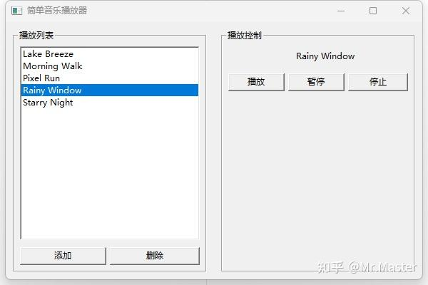

# wxWidgets 音乐播放器

一个基于 wxWidgets 框架开发的简单音乐播放器，支持播放 WAV 和 MP3 格式的音频文件。

## 项目截图

图片来自[知乎项目介绍](https://zhuanlan.zhihu.com/p/2097356538990150935)。

**音乐播放器主界面**



## 功能特性

- 🎵 支持播放 WAV 和 MP3 格式音频文件
- 📋 播放列表管理（添加、删除、选择）
- ⏯️ 播放控制（播放、暂停、停止）
- 🎨 简洁直观的用户界面
- 🌏 完整的中文界面支持

## 系统要求

- Windows 10/11
- MinGW-w64 或 Visual Studio 2019+
- CMake 3.16+
- wxWidgets 3.1.0+

## 安装依赖

### 使用 vcpkg 安装 wxWidgets（推荐）

```bash
# 安装vcpkg
git clone https://github.com/Microsoft/vcpkg.git
cd vcpkg
.\bootstrap-vcpkg.bat

# 安装wxWidgets
.\vcpkg install wxwidgets:x64-mingw-dynamic
```

### 手动安装 wxWidgets

1. 访问 [wxWidgets 官网](https://www.wxwidgets.org/downloads/)
2. 下载并安装 wxWidgets
3. 编译 wxWidgets 库

## 编译项目

### Windows 构建

#### 方法 1：使用构建脚本（推荐）

```bash
# 设置环境变量
$env:CMAKE_PREFIX_PATH = "E:\dev\vcpkg\installed\x64-mingw-dynamic"

# 运行构建脚本
.\build_simple.bat
```

#### 方法 2：手动编译

```bash
# 创建构建目录
mkdir build
cd build

# 配置项目
cmake .. -G "MinGW Makefiles" -DCMAKE_BUILD_TYPE=Release

# 编译项目
cmake --build . --config Release
```

### Linux 构建

#### 方法 1：使用构建脚本（推荐）

```bash
# 运行构建脚本
chmod +x build_linux.sh
./build_linux.sh
```

#### 方法 2：手动编译

wxWidgets在Linux上使用GTK作为底层GUI库，因此需要安装GTK开发包：

```bash
# Ubuntu/Debian
sudo apt-get update
sudo apt-get install -y cmake build-essential pkg-config
sudo apt-get install -y libgtk-3-dev
# 尝试安装wxWidgets开发包，如果3.2不存在则尝试3.0
sudo apt-get install -y libsdl2-dev libsdl2-mixer-dev
sudo apt-get install -y libwxgtk3.2-dev || sudo apt-get install -y libwxgtk3.0-dev || sudo apt-get install -y libwxgtk3.1-dev

# CentOS/RHEL/Fedora
sudo yum install -y cmake gcc-c++ pkg-config
sudo yum install -y gtk3-devel
sudo yum install -y SDL2-devel SDL2_mixer-devel
```

然后编译项目：

```bash
# 创建构建目录
mkdir build
cd build

# 配置项目
cmake .. -DCMAKE_BUILD_TYPE=Release

# 编译项目
make -j$(nproc)
```

### 自动构建（GitHub Actions）

项目配置了 GitHub Actions 自动构建：

- **Linux AppImage**: 自动构建 Linux AppImage 包
- **备用tar.gz包**: 如果AppImage构建失败，自动创建tar.gz包
- **兼容性构建**: 使用Ubuntu 20.04确保更好的向后兼容性
- **快速构建**: 使用Ubuntu系统包，构建时间短，节省GitHub Actions额度
- **自动发布**: 推送标签时自动创建 GitHub Release

查看构建状态：[](https://github.com/wangchaozhi/WXMUSICPLAYER/actions)

### 兼容性说明

如果遇到库版本问题（如 `GLIBC_2.38 not found`），请：

1. **使用本地构建**：运行 `./build_compatible.sh` 在本地编译
2. **安装运行时库**：确保系统安装了wxWidgets运行时库
3. **检查系统版本**：建议使用Ubuntu 18.04或更新版本

## 运行程序

### Windows

编译完成后，运行以下命令启动程序：

```bash
# 复制DLL文件并运行
.\run_with_dlls.bat
```

或者直接运行：

```bash
.\build\bin\wxmusicplayer.exe
```

### Linux

#### 使用AppImage（推荐）
```bash
# 下载并运行
chmod +x wxMusicPlayer-x86_64.AppImage
./wxMusicPlayer-x86_64.AppImage
```

#### 使用tar.gz包
```bash
# 解压包
tar -xzf wxMusicPlayer-Linux-x86_64.tar.gz
cd wxMusicPlayer-Linux-x86_64

# 使用运行脚本（推荐）
./run_linux.sh

# 或手动设置库路径
export LD_LIBRARY_PATH="$(pwd)/usr/lib:$LD_LIBRARY_PATH"
./usr/bin/wxmusicplayer
```

## 项目结构

```
wxmusicplayer/
├── src/                    # 源代码目录
│   └── SimpleMusicPlayer.cpp
├── include/                # 头文件目录
├── assets/                 # 资源文件目录
├── build/                  # 构建输出目录
├── CMakeLists.txt          # CMake配置文件
├── build_simple.bat        # Windows构建脚本
├── build_linux.sh          # Linux构建脚本
├── run_with_dlls.bat       # Windows运行脚本
└── README.md              # 项目说明文档
```

## 中文显示解决方案

本项目使用 `-fexec-charset=GBK` 编译器选项解决中文显示问题：

- 源代码保持 UTF-8 编码
- 编译时自动转换为 GBK 编码
- 无需使用 wxT()宏或复杂的本地化设置

## 技术栈

- **GUI 框架**: wxWidgets 3.2.6
- **构建系统**: CMake
- **编译器**: MinGW-w64
- **语言**: C++17
- **音频支持**: wxSound

## 许可证

本项目采用 MIT 许可证。详见 [LICENSE](LICENSE) 文件。

## 贡献

欢迎提交 Issue 和 Pull Request！

## 作者

[wangchaozhi](https://github.com/wangchaozhi)

## 更新日志

### v1.0.0

- 初始版本发布
- 基本播放功能
- 播放列表管理
- 中文界面支持
